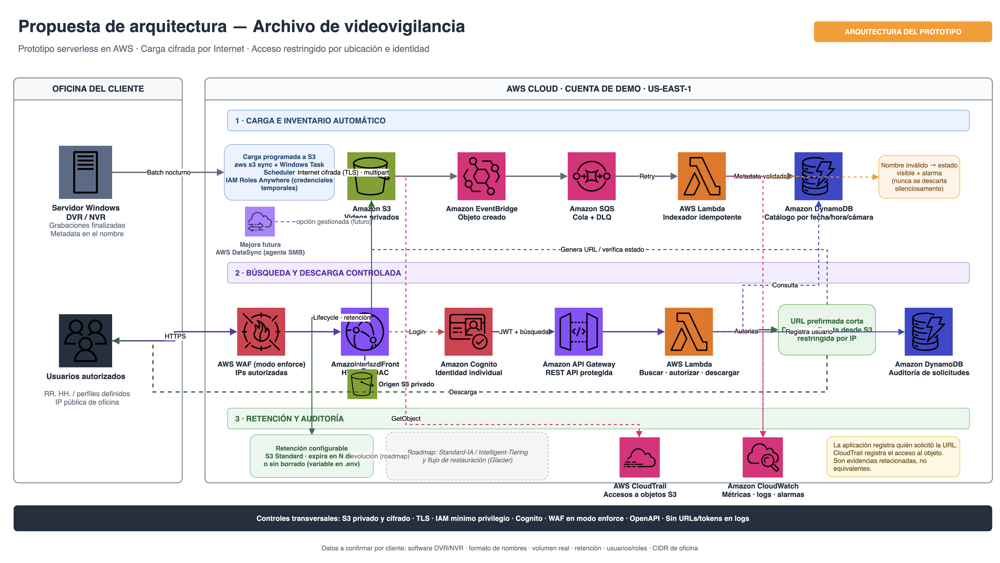
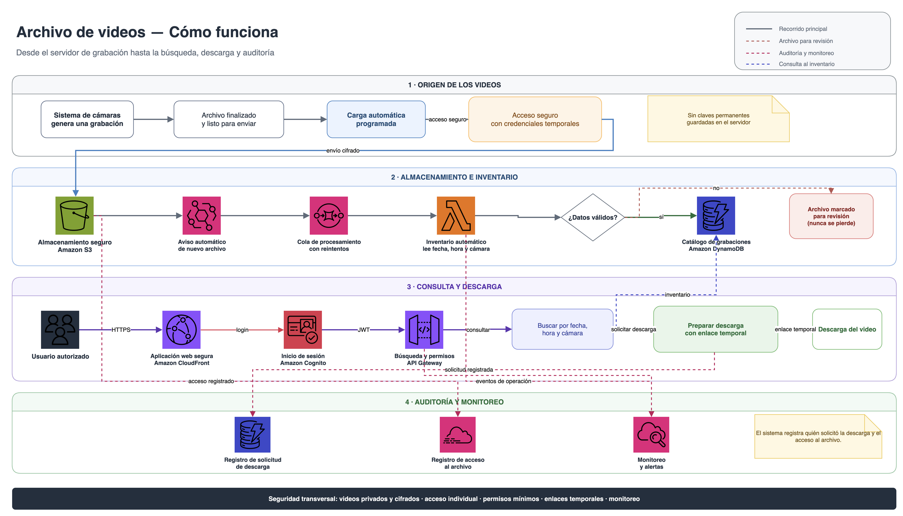

# Video Archive Prototype

**Last reviewed:** 2026-10-22

Reusable AWS prototype that ingests surveillance video files from a recording server, indexes filename metadata automatically, provides authenticated search, and supports controlled, auditable downloads.

## Current phase

**Implementation in progress. SDD requirements, design, and tasks are approved. Phases 0–6 are implemented and deployed in the demo account; hardening and final handoff tasks remain.**

## Architecture

### Client proposal

[](architecture/client-proposal-aws-icons.drawio)

Editable source: [`architecture/client-proposal-aws-icons.drawio`](architecture/client-proposal-aws-icons.drawio).

### End-to-end flow

[](architecture/end-to-end-flow.drawio)

Editable source: [`architecture/end-to-end-flow.drawio`](architecture/end-to-end-flow.drawio).

## Start here — implementation order

[`docs/implementation-manual.md`](docs/implementation-manual.md) is the canonical end-to-end runbook. Follow the stages below **in order**; do not treat the command summary as a substitute for the linked document.

| # | Stage | Follow this document | Exit criterion |
|---:|---|---|---|
| 1 | Understand scope and decisions | [`docs/implementation-manual.md`](docs/implementation-manual.md) | Account, region, Cognito-only exception, retention, pilot scope and owners agreed |
| 2 | Prepare account and workstation | [`docs/prerequisites.md`](docs/prerequisites.md) | Human deploy profile authenticated; technical IAM user exists without key/policies; tools and Windows inputs ready |
| 3 | Deploy and verify AWS | [`docs/deployment.md`](docs/deployment.md) | Preflight passes; stack completes; frontend/health return 200; anonymous API is denied; operator created |
| 4 | Configure and schedule Windows upload | [`uploader/iam-user/README.md`](uploader/iam-user/README.md) | Source profile denied S3; role profile valid; dry-run reviewed; one AVI indexed; second sync copies nothing; scheduled task healthy |
| 5 | Run the client demonstration | [`docs/demo-runbook.md`](docs/demo-runbook.md) | Login, search, download, invalid filename and audit narrative demonstrated |
| 6 | Record pilot measurements and decisions | [`docs/cost-model.md`](docs/cost-model.md) | Selected cameras/GB per day, file sizes, throughput, retrieval SLA and lifecycle scenarios recorded |
| 7 | Review lifecycle behavior | [`docs/lifecycle-states.md`](docs/lifecycle-states.md) | Archive, restore, deletion and tombstone behavior understood |
| 8 | Plan retention or removal | [`docs/teardown.md`](docs/teardown.md) | Read-only plan reviewed; no destructive mode runs without explicit approval |

Roadmap documents are **not prerequisites for the PoC**:

- [`uploader/roles-anywhere/README.md`](uploader/roles-anywhere/README.md): replace the source access key with certificate-based temporary credentials.
- [`docs/network-perimeter-options.md`](docs/network-perimeter-options.md): enable WAF/IP allowlisting before production or extended operation.

### Command summary for the approved PoC path

After completing stages 1–2 and setting `UPLOADER_IAM_USER_NAME`, `RETENTION_MODE=keep`, `IP_ALLOWLIST_MODE=disabled`, and `ROLES_ANYWHERE_ENABLED=false` in `.env`:

```bash
./scripts/preflight.sh --allow-cognito-only
./scripts/deploy-customer.sh --allow-cognito-only
./scripts/create-user.sh usuario@cliente.com
./scripts/verify-deployment.sh
./scripts/teardown.sh --plan
```

Continue with the Windows commands in [`uploader/iam-user/README.md`](uploader/iam-user/README.md) between deployment verification and teardown planning.

## Local validation

On macOS, install the project-local PowerShell LTS runtime and validate all Windows uploader scripts without changing the global system:

```bash
./scripts/install-powershell-macos.sh
make powershell-validate
```

This runs the official PowerShell parser. Cross-platform smoke tests cover empty and deferred-incomplete batches; Task Scheduler, Windows ACLs and the real AWS sync must still be validated on the customer's Windows Server.

> The current template does not yet implement WAF for CloudFront/API. `preflight.sh` therefore blocks `IP_ALLOWLIST_MODE=enforce`. An explicitly approved Cognito-only pilot may use `--allow-cognito-only`; do not describe that mode as office-IP restricted.

## Documents

- [`planning/explore-phase.md`](planning/explore-phase.md): refined scope, architecture hypothesis, risks, open questions, and evidence.
- [`planning/sdd-kickoff-prompt.md`](planning/sdd-kickoff-prompt.md): instruction used to initiate the SDD planning session.
- [`.kiro/steering/engineering-documentation-standards.md`](.kiro/steering/engineering-documentation-standards.md): mandatory clean-code, documentation, testing, security, and maintainability standards.
- [`architecture/conceptual-architecture.drawio`](architecture/conceptual-architecture.drawio): editable technical architecture diagram.
- [`architecture/client-proposal-aws-icons.drawio`](architecture/client-proposal-aws-icons.drawio): client-facing proposal using native AWS Architecture Icons.
- [`architecture/end-to-end-flow.drawio`](architecture/end-to-end-flow.drawio): end-to-end flow for ingestion, indexing, search, download, and audit.
- [`docs/cost-model.md`](docs/cost-model.md): P×Q cost model the customer can run with their own volume, retention, retrieval SLA, and lifecycle options.
- [`docs/lifecycle-states.md`](docs/lifecycle-states.md): object deletion, archive/restore state transitions, timestamps, idempotency, and tombstone scalability.
- [`docs/implementation-manual.md`](docs/implementation-manual.md): end-to-end client implementation manual covering AWS login/SSO, deployment, the PoC IAM-user-to-role uploader, validation, Roles Anywhere roadmap, and teardown.
- [`uploader/iam-user/README.md`](uploader/iam-user/README.md): simplified PoC credential path using a unique IAM technical user only to assume the scoped uploader role.
- [`uploader/roles-anywhere/README.md`](uploader/roles-anywhere/README.md): roadmap migration to certificate-based temporary credentials without a long-lived AWS key.
- [`docs/prerequisites.md`](docs/prerequisites.md): account, tooling, security, and Windows inputs required before deployment.
- [`docs/deployment.md`](docs/deployment.md): customer-account deployment walkthrough.
- [`docs/teardown.md`](docs/teardown.md): plan-first retain-data and purge-data procedures.
- [`docs/network-perimeter-options.md`](docs/network-perimeter-options.md): IP allowlist with WAF (default) versus without WAF, including trade-offs.
- [`docs/demo-runbook.md`](docs/demo-runbook.md): step-by-step client demo walkthrough.
- [`.kiro/specs/cctv-storeindexer/requirements.md`](.kiro/specs/cctv-storeindexer/requirements.md): approved MVP requirements (EARS).
- [`.kiro/specs/cctv-storeindexer/design.md`](.kiro/specs/cctv-storeindexer/design.md): approved technical design and ADRs.
- [`.kiro/specs/cctv-storeindexer/tasks.md`](.kiro/specs/cctv-storeindexer/tasks.md): approved, traceable implementation task breakdown.

## Technology baseline

- Infrastructure as code: AWS SAM/CloudFormation.
- Frontend: React, TypeScript, and Material UI.
- Edge and access: Amazon CloudFront, Amazon Cognito, and private Amazon S3 origins; AWS WAF IP allowlist remains pending hardening.
- API and processing: Amazon API Gateway REST API, AWS Lambda, Amazon EventBridge, Amazon SQS, and a dead-letter queue.
- Catalog and audit: Amazon DynamoDB; CloudTrail S3 data events remain pending hardening.
- Video storage: Amazon S3 Standard with configurable retention; Intelligent-Tiering/archive recovery remains roadmap.
- On-premises PoC credentials: a unique technical IAM user can only assume a scoped, write-only uploader role; IAM Roles Anywhere is the preferred roadmap; AWS DataSync remains a future scale option.

## Customer pilot baseline

Customer evidence confirmed on 2026-10-21:

- Current local estate: approximately **90 TB across all cameras**. This is a reference point, not a commitment to upload all 90 TB to AWS.
- Target retention discussed: approximately **3 months (90 days)**.
- Recordings: many small AVI files; exact file count, size distribution, total camera count and selected cloud GB/day remain to be measured.
- Retrieval: irregular, from multiple requests in a week to several weeks with no downloads.
- Agreed approach: deploy a bounded pilot with **3–5 representative cameras**, approximately **7 days** and a **250–500 GB** planning range, then use measured throughput, file count, retrieval SLA and costs to choose the wider rollout.

The pilot uses S3 Standard and scheduled `aws s3 sync`. For the simplified PoC, a unique IAM technical user's access key can only assume the scoped uploader role and must be retired at pilot close. IAM Roles Anywhere is the preferred credential roadmap. The rollout cost model compares Standard, Standard→Standard-IA, Glacier Instant Retrieval and Glacier Flexible Retrieval. AWS DataSync and the final lifecycle are selected only after pilot measurements.

## Remaining work

- Complete CloudTrail, alarms, threat model, final E2E evidence, customer handoff, and WAF validation.
- Validate the IAM-user-to-role uploader profiles, safe sync, Task Scheduler, finished-folder contract and backlog recovery on the customer's Windows Server.
- Before production or extended operation, replace the source access key with IAM Roles Anywhere and enable WAF.
- Confirm customer filename grammar, volume, retention, users/roles, and office CIDRs before production use.

## License

Licensed under [MIT No Attribution (MIT-0)](LICENSE).
